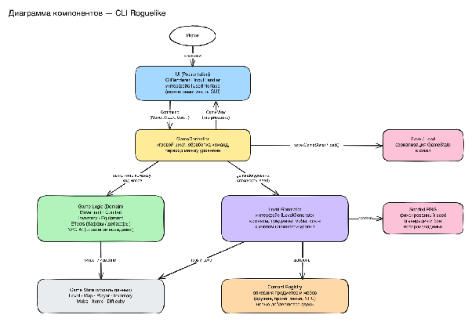
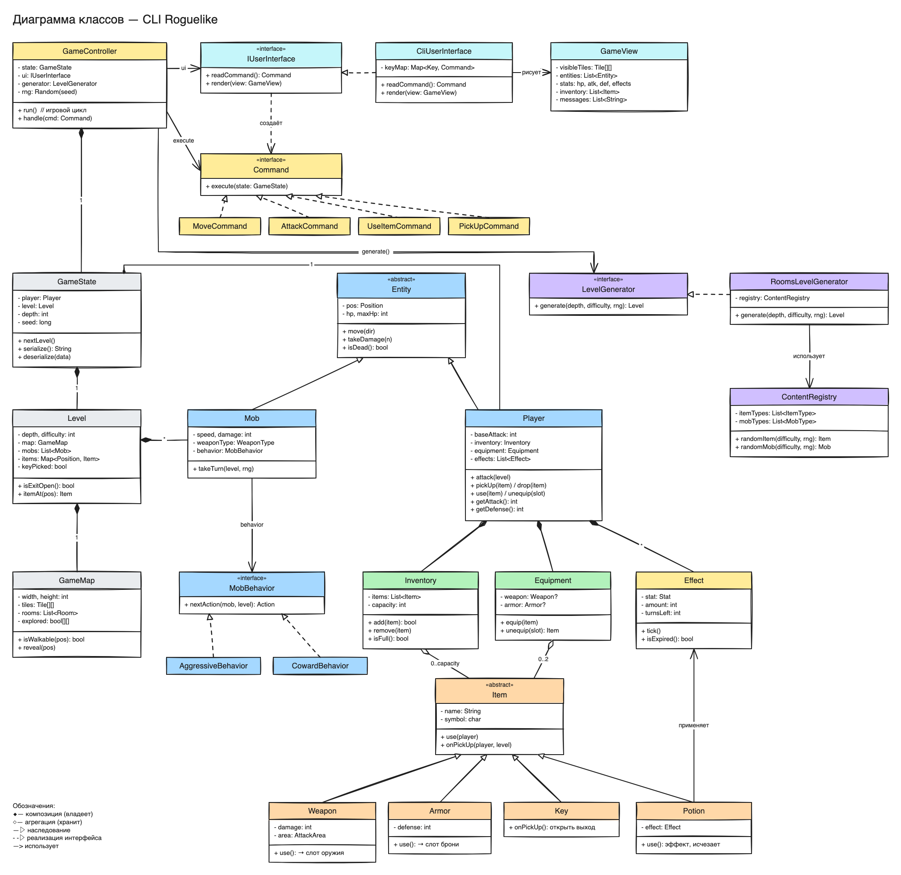
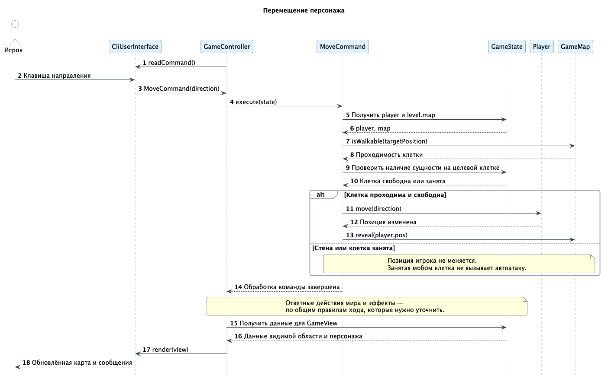
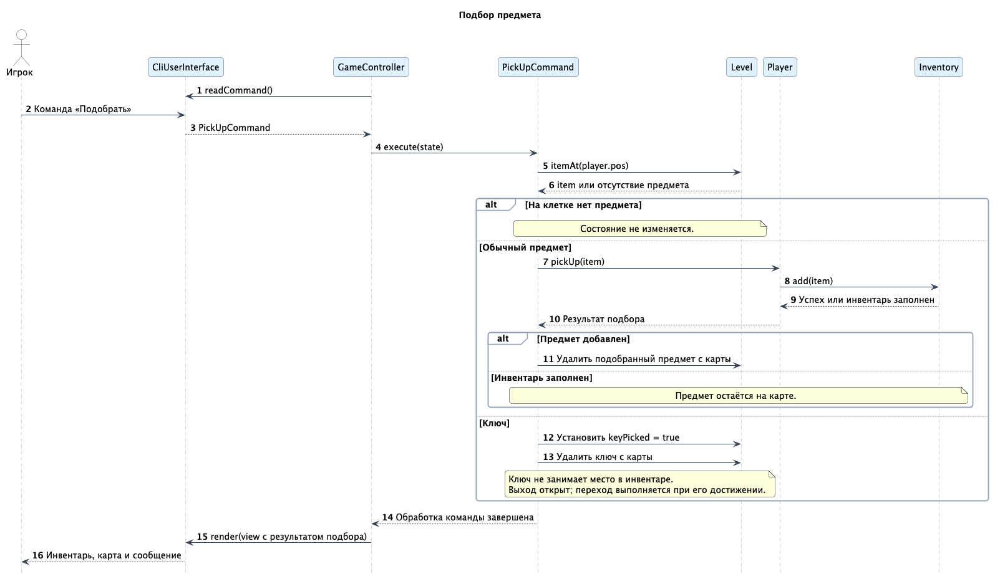
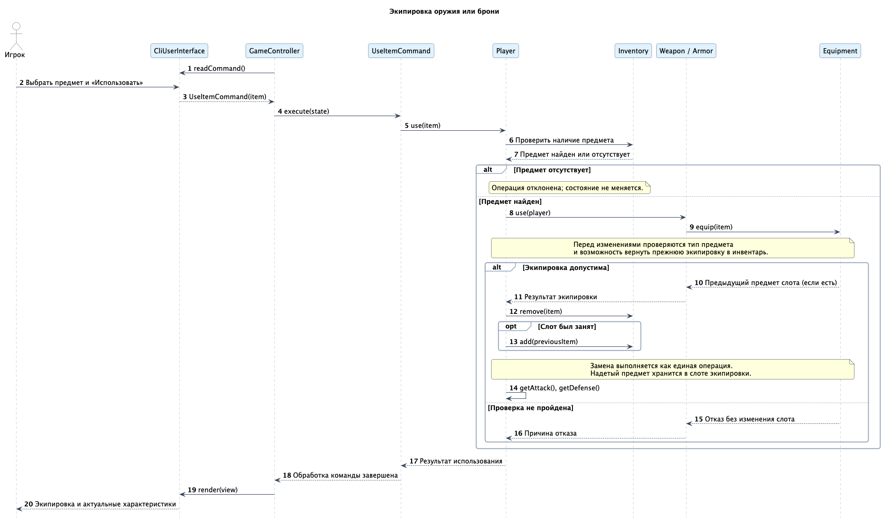
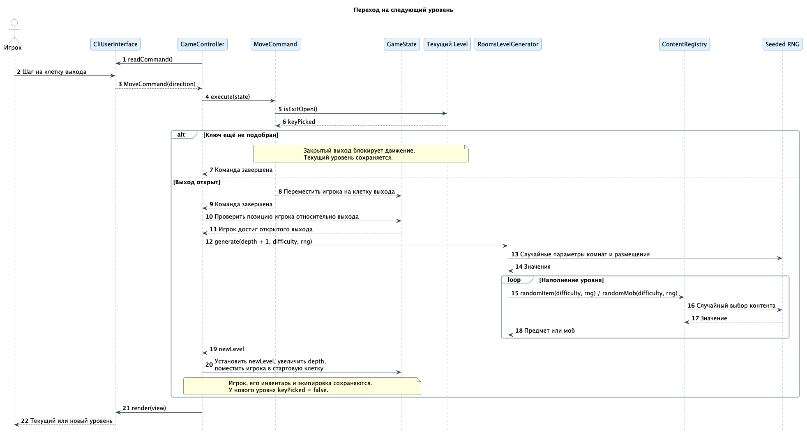
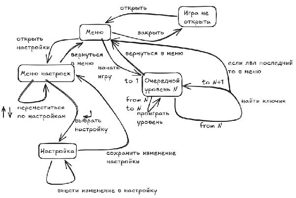

# Архитектура CLI Roguelike

Статус: рабочий проект на основе набросков команды.

## Содержание

1. [Общие сведения о системе](#1-общие-сведения-о-системе)
2. [Архитектурные драйверы](#2-архитектурные-драйверы)
3. [Роли, пользователь и сценарии](#3-роли-пользователь-и-сценарии)
4. [Композиция системы](#4-композиция-системы)
5. [Логическая структура](#5-логическая-структура)
6. [Взаимодействия и состояния](#6-взаимодействия-и-состояния)

## 1. Общие сведения о системе

CLI Roguelike — консольная игра с исследованием уровней, сражениями и сбором предметов. Игрок управляет персонажем с клавиатуры. Игра ориентирована на любителей классических Roguelike и консольной графики.

### Основные возможности

- Мир состоит из нескольких уровней. Карты, комнаты, предметы, противники и ключи размещаются процедурно.
- Персонаж перемещается по карте; стены и закрытые проходы ограничивают движение.
- У персонажа есть здоровье, сила атаки, защита и временные положительные или отрицательные эффекты.
- Предметы можно подбирать, хранить в инвентаре, использовать и выбрасывать.
- Для экипировки предусмотрены один слот оружия и один слот брони. Экипировка влияет на характеристики персонажа; снятые вещи возвращаются в инвентарь.
- Зелья накладывают эффекты и расходуются при использовании.
- На уровнях находятся враждебные NPC — мобы. Они различаются здоровьем, скоростью, уроном, типом оружия и поведением.
- Оружие поражает противников в своей зоне атаки.
- Для открытия выхода на следующий уровень требуется подобрать ключ текущего уровня.
- Сложность растёт при переходе на следующие уровни и влияет на подбор предметов и противников.
- Состояние мира и доступные игроку сведения отображаются в консоли.

### Требования задания, которые ещё нужно отразить в проекте

В задании предусмотрена загрузка некоторых уровней из файла. В набросках описана только процедурная генерация: загрузку необходимо включить в дальнейшее проектирование.

Задание также предполагает перманентную смерть. Идея возрождения из набросков требует отдельного согласования; в основной сценарий она не включена.

## 2. Архитектурные драйверы

Архитектурные драйверы — требования и ограничения, определяющие устройство системы.

| Драйвер | Следствие для архитектуры |
| --- | --- |
| Консольный интерфейс с возможностью заменить оболочку | Ввод и вывод отделяются от игровой логики интерфейсом `IUserInterface`. |
| Процедурная генерация с учётом сложности | Генератор выделяется в отдельный компонент за интерфейсом `LevelGenerator`. |
| Добавление оружия, брони и зелий | Общие свойства предметов задаются через `Item`, виды контента собираются в `ContentRegistry`. |
| Разные свойства и алгоритмы поведения NPC | Характеристики моба отделяются от стратегии `MobBehavior`. |
| Воспроизводимость случайных событий | Генерация и бои используют управляемый источник случайных чисел, начальное значение которого задаётся через seed. |
| Сериализация состояния | Данные игрового сеанса отделяются от интерфейса и цикла выполнения; сохранение выполняет отдельный компонент. |
| Регулярное появление новых требований | Интерфейс, управление игрой, модель мира и создание уровней имеют отдельные обязанности. |

Для воспроизведения сеанса недостаточно одного seed: нужны также одинаковая последовательность команд, версия правил и порядок обращений к генератору случайных чисел. Для точного продолжения сохранённой игры потребуется сохранять текущее состояние генератора либо эквивалентную информацию.

## 3. Роли, пользователь и сценарии

### Роли

**Игрок** управляет персонажем, исследует уровни, сражается и собирает предметы.

**Разработчик или геймдизайнер** добавляет предметы, мобов и правила, настраивает баланс. Это участник разработки и сопровождения; отдельный внутриигровой редактор в набросках не предусмотрен.

### Типичный пользователь

Любитель классических Roguelike, знакомый с управлением с клавиатуры и условными обозначениями консольной карты. Ему нужны понятные сведения о здоровье, экипировке, предметах и результатах действий.

### Случаи использования

| Сценарий | Действия и результат |
| --- | --- |
| Начать игру | Игрок выбирает новую игру. Создаётся первый уровень, персонаж появляется в стартовой комнате с базовыми характеристиками. |
| Просмотреть характеристики | Интерфейс показывает здоровье, атаку, защиту и активные эффекты с оставшейся длительностью. |
| Переместиться и исследовать карту | Игрок выбирает направление. При допустимом перемещении позиция меняется, видимая область обновляется. |
| Подобрать предмет | Игрок находится на клетке с предметом и выполняет команду подбора. Если есть место, предмет переносится с карты в инвентарь. |
| Экипировать предмет | Игрок выбирает оружие или броню в инвентаре. Предмет занимает соответствующий слот, характеристики пересчитываются. |
| Использовать зелье | Игрок выбирает зелье. Оно накладывает эффект и удаляется из инвентаря. |
| Снять экипировку | Выбранная вещь возвращается в инвентарь, её влияние на характеристики прекращается. |
| Выбросить предмет | Предмет удаляется из инвентаря и появляется на текущей клетке карты. |
| Атаковать | Игрок выполняет команду атаки. Противники в зоне поражения оружия получают урон. |
| Подобрать ключ | Ключ исчезает с карты, выход текущего уровня открывается. |
| Перейти на следующий уровень | Игрок достигает открытого выхода. Создаётся следующий уровень с увеличенной сложностью. |
| Завершить игру после смерти | При смерти персонажа текущий забег завершается, игрок возвращается в главное меню и может начать новую игру. |

В набросках предложены стрелки, WASD и hjkl. Окончательная раскладка и назначение остальных команд пока не определены.

## 4. Композиция системы



### Ответственность компонентов

| Компонент | Ответственность |
| --- | --- |
| CLI / `IUserInterface` | Читает ввод, преобразует его в команды и отображает `GameView`. |
| `GameController` | Управляет игровым циклом, передаёт команды модели, запрашивает создание уровней и обновляет представление. |
| Game Logic / Domain | Содержит правила движения, боя, предметов, характеристик и поведения мобов. |
| Game State | Хранит состояние сеанса: игрока, текущий уровень, глубину и данные воспроизводимости. |
| Level Generator | Создаёт карту и наполняет уровень с учётом глубины, сложности и источника случайных чисел. |
| Content Registry | Предоставляет типы предметов и мобов для наполнения уровней. |
| Seeded RNG | Обеспечивает управляемую случайность для генерации и игровых событий. |
| Save / Load | Сохраняет и восстанавливает состояние сеанса. Правила использования сохранений ещё нужно согласовать. |

### Запуск и поток управления

Точка входа приложения создаёт модель состояния, источник случайных чисел, реестр контента, генератор уровней, CLI и `GameController`, затем вызывает `GameController.run()`.

Контроллер получает команду через `IUserInterface.readCommand()`, применяет её к игровому состоянию и организует дальнейшее обновление мира. После обработки действия формируется `GameView`, который передаётся в `IUserInterface.render(view)`.

`GameView` содержит сведения для отображения: доступные игроку клетки и сущности, характеристики, инвентарь и сообщения. Правила видимости определяет игровая логика; интерфейс отображает подготовленные данные.

На исходной диаграмме источник случайности явно связан с генератором уровней. Согласно драйверу воспроизводимости он также должен быть доступен боевой логике и поведению мобов.

## 5. Логическая структура



### Управление и представление

- `GameController` владеет текущим `GameState`, использует `IUserInterface`, `LevelGenerator` и источник случайных чисел.
- `IUserInterface` задаёт операции чтения команды и отображения представления. `CliUserInterface` реализует их для консоли.
- `Command` задаёт выполнение действия над `GameState`. На диаграмме показаны `MoveCommand`, `AttackCommand`, `UseItemCommand` и `PickUpCommand`.
- `GameView` представляет данные для интерфейса.

### Мир и персонажи

- `GameState` объединяет игрока, текущий уровень, глубину прохождения и seed.
- `Level` хранит карту, мобов, предметы и признак получения ключа. Проверяет доступность выхода и наличие предмета на клетке.
- `GameMap` хранит клетки, комнаты и сведения об исследованных областях; предоставляет проверки проходимости.
- `Entity` содержит общие свойства игрока и мобов: позицию и здоровье.
- `Player` дополняет сущность атакой, инвентарём, экипировкой и активными эффектами.
- `Mob` содержит характеристики противника и использует `MobBehavior` для выбора действия. На диаграмме представлены агрессивная и трусливая стратегии.

### Предметы и эффекты

- `Inventory` хранит переносимые предметы и ограничение вместимости.
- `Equipment` хранит ссылки на выбранное оружие и броню.
- `Item` задаёт общие свойства и операции предмета. Его разновидности: `Weapon`, `Armor`, `Key` и `Potion`.
- `Weapon` определяет урон и зону поражения, `Armor` — защиту.
- `Key` открывает выход при подборе, `Potion` применяет эффект и расходуется.
- `Effect` описывает изменение характеристики, величину изменения и оставшееся число ходов.

### Создание уровней

`LevelGenerator` задаёт интерфейс создания уровня. `RoomsLevelGenerator` реализует генерацию комнат и использует `ContentRegistry` для выбора подходящих предметов и мобов.

### Уточнения к исходной диаграмме

Изображение сохранено в исходном виде. Перед реализацией нужно согласовать следующие детали:

- Сценарии предусматривают снятие и выбрасывание предметов, но соответствующие команды на диаграмме не показаны.
- Между `GameState.nextLevel()` и контроллером нужно явно распределить ответственность за переход и вызов генератора.
- На диаграмме сериализация включена в `GameState`, а на диаграмме компонентов есть отдельный Save / Load. Нужно определить границу между преобразованием данных и файловым вводом-выводом.
- Представление предметов как `Map<Position, Item>` допускает только один предмет на клетке. Это влияет на выбрасывание вещей и требует выбора правила.
- Необходимо определить, перемещается ли экипированный предмет из списка инвентаря в слот или остаётся в списке. Тексты сценариев предполагают перенос в слот и возврат при снятии.

## 6. Взаимодействия и состояния

### Обработка игровой команды

Ниже приведена общая последовательность обработки команды. Диаграммы отдельных сценариев представлены далее в этом разделе.

1. Игрок вводит команду с клавиатуры.
2. `CliUserInterface.readCommand()` возвращает объект `Command`.
3. `GameController.handle(command)` вызывает `command.execute(state)`.
4. Команда обращается к объектам игровой модели; они проверяют условия и изменяют состояние при допустимом действии.
5. Контроллер организует ответные действия мобов, обновление эффектов и проверку смерти или перехода на следующий уровень. Точный порядок и условия расходования хода пока не определены.
6. На основе состояния формируется `GameView`.
7. `CliUserInterface.render(view)` обновляет консольное представление.

### Диаграммы последовательностей

Сплошные стрелки показывают вызовы и действия, пунктирные — ответы. Блок `alt` задаёт альтернативные ветви, `opt` — необязательный шаг, `loop` — повторение. Подписи на русском описывают операции, для которых точные имена методов ещё не зафиксированы на диаграмме классов.

#### Перемещение персонажа



CLI преобразует ввод в `MoveCommand`. Команда проверяет проходимость и занятость клетки, затем перемещает персонажа и обновляет исследованную область. Если движение невозможно, позиция сохраняется. Контроллер получает данные модели, формирует `GameView` и обновляет экран.

#### Подбор предмета или ключа



`PickUpCommand` запрашивает предмет на клетке игрока. Обычный предмет удаляется с карты только после успешного добавления в инвентарь. При переполнении он остаётся на месте. Подбор ключа открывает выход и удаляет ключ с карты; сам переход выполняется при достижении выхода.

#### Экипировка оружия или брони



`UseItemCommand` передаёт выбранный предмет игроку. После проверки наличия предмета вызывается его операция `use(player)`, которая обращается к экипировке. Новый предмет переносится в слот, предыдущий возвращается в инвентарь. Перед изменениями проверяются условия замены; вся операция должна завершиться целиком либо оставить состояние прежним. Интерфейс получает актуальные характеристики.

#### Переход на следующий уровень



Если ключ не подобран, выход блокирует перемещение. После достижения открытого выхода контроллер вызывает `LevelGenerator.generate()` с новой глубиной, соответствующей сложностью и общим источником случайных чисел. Генератор создаёт карту и выбирает контент через `ContentRegistry`. Затем контроллер заменяет уровень в `GameState` и размещает существующего игрока в стартовой клетке. Это сценарий обычного перехода, без обработки последнего уровня и ошибок генерации.

#### Уточнения, принятые для диаграмм

Для конкретного описания сценариев использованы следующие проектные уточнения:

- Занятая мобом клетка блокирует перемещение; атака выполняется отдельной командой.
- Ключ применяется сразу при подборе и не занимает место в инвентаре.
- Экипированный предмет хранится в слоте, а при замене возвращается в инвентарь. Вместимость проверяется с учётом освобождения места выбранным предметом.
- Контроллер отвечает за вызов генератора и установку нового уровня; модель хранит полученное состояние.

Эти уточнения ещё нужно перенести в чистовую диаграмму классов. Частота действий мобов, расходование ходов и порядок обновления эффектов остаются открытыми вопросами. На диаграммах подбора, экипировки и перехода общая фаза обновления мира опущена; `render(view)` подразумевает предварительное формирование `GameView` контроллером из данных модели.

#### Повторный рендер

Нужны Java и файл `plantuml.jar`. Запуск из корня репозитория:

```sh
java -Djava.awt.headless=true -jar /path/to/plantuml.jar \
  -charset UTF-8 -tpng -o ../images 'docs/diagrams/*.puml'
```

PNG сохраняются в `docs/images`. Для этих диаграмм последовательностей Graphviz не требуется.

### Состояния приложения



Эскиз описывает следующие состояния и переходы:

| Состояние | Основные переходы |
| --- | --- |
| Приложение закрыто | Запуск → главное меню. |
| Главное меню | Новая игра → первый уровень; настройки → меню настроек; выход → закрытие приложения. |
| Меню настроек | Выбор параметра → редактирование; возврат → главное меню. |
| Редактирование настройки | Изменение значения; сохранение → меню настроек. |
| Игра на уровне N | Смерть или возврат → главное меню; прохождение уровня → уровень N + 1. |

На эскизе переход к следующему уровню подписан «найти ключик». В сценариях ключ только открывает выход, поэтому переход следует уточнить: «подобрать ключ → открыть выход → достичь выхода → следующий уровень».

Эскиз также предполагает возврат в меню после последнего уровня. Число уровней и условие завершения забега пока не определены. Состав настроек на эскизе не раскрыт.
